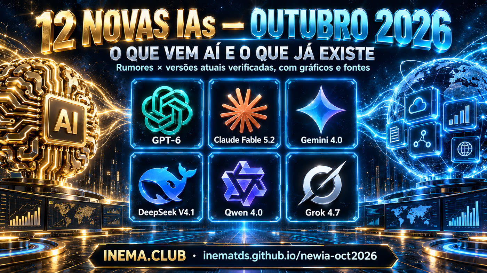

# 12 New AIs — October 2026

**🇧🇷 [Português](README.md) · 🇺🇸 [English](README.en.md) · 🇪🇸 [Español](README.es.md)**

[](https://inematds.github.io/newia-oct2026/guia/en/)

Research dossier on the **12 AIs rumored to be announced for October 2026** — GPT Bel, GPT-6 Sol,
Claude Fable 5.2, Claude Opus 5.1, Grok 4.7, DeepSeek V4.1 Pro, GLM-5.5, Kimi K3.1, Qwen 4.0, Gemini 4.0,
Muse Spark 1.4, and Xiaomi MiMo-V3 — each compared with the **verified current version** in its lineage
(price, context, benchmarks, timeline), with sources, charts, and an assessment of practical utility.

Research status: **2026-09-15**. Rumor and fact are kept separate: every number has a source URL; without a URL, it is marked
`unverified`.

## 📖 Project page

Landing page + full dossier, with charts: **https://inematds.github.io/newia-oct2026/guia/en/**

## Structure

| Path | What it is |
|---|---|
| `modelos/<slug>.md` | One dossier per model (lineage, verified current version, timeline, rumor, what changes, utility, sources, structured JSON). |
| `data/modelos.json` | Structured data extracted from the 12 dossiers (generated). |
| `guia/index.html` | Single, self-contained page with SVG charts (generated). |
| `scripts/extrai-dados.mjs` | Reads the JSON blocks from the Markdown files and writes `data/modelos.json`. |
| `scripts/gera-pagina.mjs` | Renders `guia/index.html` from the Markdown files + JSON. |
| `capa/capa.png` | Official INEMA cover (catalog). |

## Update when October arrives

1. Edit the model dossier in `modelos/<slug>.md` (text and the JSON block at the end — change `status` to `announced` or `released`).
2. Regenerate and publish:

```bash
node scripts/extrai-dados.mjs && node scripts/gera-pagina.mjs
git add -A && git commit -m "dossiê: <modelo> atualizado" && git push
```

## The 12 dossiers

| Rumor | Dossier |
|---|---|
| GPT Bel | [modelos/gpt-bel.md](modelos/gpt-bel.md) |
| GPT-6 Sol | [modelos/gpt-6-sol.md](modelos/gpt-6-sol.md) |
| Claude Fable 5.2 | [modelos/claude-fable-5-2.md](modelos/claude-fable-5-2.md) |
| Claude Opus 5.1 | [modelos/claude-opus-5-1.md](modelos/claude-opus-5-1.md) |
| Grok 4.7 | [modelos/grok-4-7.md](modelos/grok-4-7.md) |
| DeepSeek V4.1 Pro | [modelos/deepseek-v4-1-pro.md](modelos/deepseek-v4-1-pro.md) |
| GLM-5.5 (Z.AI) | [modelos/glm-5-5.md](modelos/glm-5-5.md) |
| Kimi K3.1 | [modelos/kimi-k3-1.md](modelos/kimi-k3-1.md) |
| Qwen 4.0 | [modelos/qwen-4.md](modelos/qwen-4.md) |
| Gemini 4.0 | [modelos/gemini-4.md](modelos/gemini-4.md) |
| Muse Spark 1.4 | [modelos/muse-spark-1-4.md](modelos/muse-spark-1-4.md) |
| Xiaomi MiMo-V3-Pro / Flash | [modelos/xiaomi-mimo-v3.md](modelos/xiaomi-mimo-v3.md) |

---

Community project by **[INEMA.CLUB](https://inema.club)** · rumors not independently verified.
