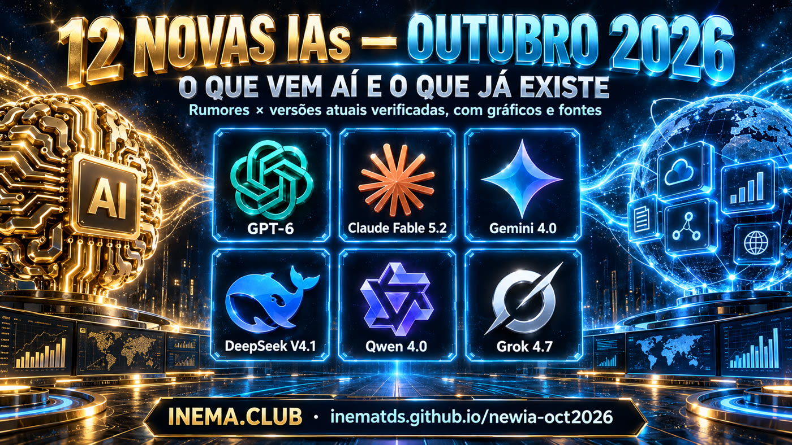

# 12 nuevas IA — Octubre de 2026

**🇧🇷 [Português](README.md) · 🇺🇸 [English](README.en.md) · 🇪🇸 [Español](README.es.md)**

[](https://inematds.github.io/newia-oct2026/guia/es/)

Dossier de investigación sobre las **12 IA anunciadas (como rumor) para octubre de 2026** — GPT Bel, GPT-6 Sol,
Claude Fable 5.2, Claude Opus 5.1, Grok 4.7, DeepSeek V4.1 Pro, GLM-5.5, Kimi K3.1, Qwen 4.0, Gemini 4.0,
Muse Spark 1.4 y Xiaomi MiMo-V3 — cada una comparada con la **versión actual verificada** de su linaje
(precio, contexto, benchmarks, línea de tiempo), con fuentes, gráficos y una lectura de utilidad práctica.

Estado de la investigación: **2026-09-15**. Los rumores y los hechos se mantienen separados: cada cifra tiene una URL de fuente; sin URL, queda como `não verificado`.

## 📖 Página del proyecto

Landing + dossier completo, con gráficos: **https://inematds.github.io/newia-oct2026/guia/es/**

## Estructura

| Ruta | Qué es |
|---|---|
| `modelos/<slug>.md` | Un dossier por modelo (linaje, versión actual verificada, línea de tiempo, rumor, qué cambia, utilidad, fuentes, JSON estructurado). |
| `data/modelos.json` | Datos estructurados extraídos de los 12 dossieres (generado). |
| `guia/index.html` | Página única, autocontenida, con gráficos SVG (generada). |
| `scripts/extrai-dados.mjs` | Lee los bloques JSON de los markdown y escribe `data/modelos.json`. |
| `scripts/gera-pagina.mjs` | Genera `guia/index.html` a partir de los markdown + JSON. |
| `capa/capa.png` | Portada oficial de INEMA (catálogo). |

## Actualizar cuando llegue octubre

1. Edita el dossier del modelo en `modelos/<slug>.md` (texto y bloque JSON al final; cambia `status` a `anunciado` o `lancado`).
2. Regenera y publica:

```bash
node scripts/extrai-dados.mjs && node scripts/gera-pagina.mjs
git add -A && git commit -m "dossiê: <modelo> atualizado" && git push
```

## Los 12 dossieres

| Rumor | Dossier |
|---|---|
| GPT Bel | [modelos/gpt-bel.md](modelos/gpt-bel.md) |
| GPT-6 Sol | [modelos/gpt-6-sol.md](modelos/gpt-6-sol.md) |
| Claude Fable 5.2 | [modelos/claude-fable-5-2.md](modelos/claude-fable-5-2.md) |
| Claude Opus 5.1 | [modelos/claude-opus-5-1.md](modelos/claude-opus-5-1.md) |
| Grok 4.7 | [modelos/grok-4-7.md](modelos/grok-4-7.md) |
| DeepSeek V4.1 Pro | [modelos/deepseek-v4-1-pro.md](modelos/deepseek-v4-1-pro.md) |
| GLM-5.5 (Z.AI) | [modelos/glm-5-5.md](modelos/glm-5-5.md) |
| Kimi K3.1 | [modelos/kimi-k3-1.md](modelos/kimi-k3-1.md) |
| Qwen 4.0 | [modelos/qwen-4.md](modelos/qwen-4.md) |
| Gemini 4.0 | [modelos/gemini-4.md](modelos/gemini-4.md) |
| Muse Spark 1.4 | [modelos/muse-spark-1-4.md](modelos/muse-spark-1-4.md) |
| Xiaomi MiMo-V3-Pro / Flash | [modelos/xiaomi-mimo-v3.md](modelos/xiaomi-mimo-v3.md) |

---

Proyecto de la comunidad **[INEMA.CLUB](https://inema.club)** · rumores no verificados de forma independiente.
